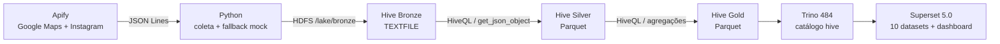

# Passo a passo — Lakehouse AGR Goiás

> Registro técnico de **cada ação, comando, erro e decisão** tomada durante a
> construção do pipeline. Data da execução/validação: **18/11/2026**.

---

## Sumário

1. [Objetivo e ponto de partida](#1-objetivo-e-ponto-de-partida)
2. [Arquitetura final](#2-arquitetura-final)
3. [Fase 1 — Descoberta do ambiente](#3-fase-1--descoberta-do-ambiente)
4. [Fase 2 — Extração com Apify](#4-fase-2--extração-com-apify)
5. [Fase 3 — Escolha da stack e das versões](#5-fase-3--escolha-da-stack-e-das-versões)
6. [Fase 4 — Consolidação da estrutura do projeto](#6-fase-4--consolidação-da-estrutura-do-projeto)
7. [Fase 5 — Coleta canônica e dados](#7-fase-5--coleta-canônica-e-dados)
8. [Fase 6 — Infraestrutura Docker](#8-fase-6--infraestrutura-docker)
9. [Fase 7 — Camadas HiveQL](#9-fase-7--camadas-hiveql)
10. [Fase 8 — Subida da stack e incidentes](#10-fase-8--subida-da-stack-e-incidentes)
11. [Fase 9 — Pipeline e validação](#11-fase-9--pipeline-e-validação)
12. [Resultados consolidados](#12-resultados-consolidados)
13. [Decisões e justificativas](#13-decisões-e-justificativas)
14. [Comandos de operação](#14-comandos-de-operação)
15. [Segurança, custos e limitações](#15-segurança-custos-e-limitações)
16. [Estado final e reprodutibilidade](#16-estado-final-e-reprodutibilidade)

---

## 1. Objetivo e ponto de partida

O pedido inicial foi usar o **Apify** para extrair dados de duas fontes públicas
da **AGR — Agência Goiana de Regulação, Controle e Fiscalização de Serviços
Públicos**:

- uma página do **Google Maps** (dados do lugar + avaliações);
- o perfil **Instagram `@agrgoias`** (perfil + posts).

Em seguida, o projeto evoluiu para a arquitetura de lakehouse:

```
Python (coleta) → HDFS (Data Lake) → Hive (Bronze/Silver/Gold) → Trino → Superset
```

### Estado inicial encontrado

| Item | Situação |
|------|----------|
| Diretório `PI VB` | vazio no início |
| Repositório git | a raiz era `C:\Users\vigon` (home), não a pasta do projeto |
| Python | 3.13.5 |
| pandas / pyarrow | 2.3.2 / 25.0.1 |
| Node.js | 22.17.1 |
| Docker | **não instalado** |
| WSL | `wsl.exe` presente, mas **sem distribuição** instalada |
| Java no host | OpenJDK 17 (não usado pela stack; os containers têm seu próprio Java) |
| Espaço em disco | ~630 GB livres |

### Primeira decisão

Antes de escrever qualquer código, validar a chave do Apify e inspecionar o
schema real dos atores, para não gastar créditos com um input inválido.

---

## 2. Arquitetura final



| Camada | Formato | Conteúdo |
|--------|---------|----------|
| Bronze | JSON Lines / TEXTFILE | um registro por linha, como veio do Apify |
| Silver | Parquet | limpeza, tipagem, texto normalizado e visão unificada |
| Gold | Parquet | 10 tabelas analíticas prontas para BI |
| Consumo | SQL | Trino para consultas; Superset para dashboards |

---

## 3. Fase 1 — Descoberta do ambiente

### Ações

1. Listei o diretório e o estado do git; descobri que a pasta `PI VB` estava
   vazia e o repositório era a home do usuário.
2. Verifiquei Python, curl, Node, Java, pandas/pyarrow.
3. Testei a chave do Apify com `GET /v2/users/me` (plano **Free**, US$ 5/mês,
   uso inicial zero).
4. Consultei os metadados dos atores para descobrir os campos de entrada reais.

### Decisão

Usar apenas **três execuções** do Apify (perfil, posts e lugar/reviews) e
limitar a coleta para manter o custo baixo no plano Free.

---

## 4. Fase 2 — Extração com Apify

### 4.1 Atores escolhidos

| Fonte | Ator | Finalidade |
|-------|------|------------|
| Google Maps | `compass/crawler-google-places` | detalhes do lugar + avaliações |
| Instagram | `apify/instagram-scraper` com `resultsType=details` | perfil |
| Instagram | `apify/instagram-scraper` com `resultsType=posts` | posts |

### 4.2 Schemas e inputs

O schema foi lido a partir do build do ator
(`/v2/actor-builds/{buildId}`), que expõe o `inputSchema`.

Input do Google Maps:

```json
{
  "startUrls": [{ "url": "<url do lugar>" }],
  "maxCrawledPlacesPerSearch": 1,
  "language": "pt-BR",
  "countryCode": "br",
  "scrapePlaceDetailPage": true,
  "maxReviews": 50,
  "scrapeReviewsPersonalData": false,
  "maxImages": 0,
  "scrapeContacts": false,
  "includeWebResults": false
}
```

Inputs do Instagram:

```json
{ "directUrls": ["https://www.instagram.com/agrgoias/"], "resultsType": "details" }
```

```json
{ "directUrls": ["https://www.instagram.com/agrgoias/"], "resultsType": "posts", "resultsLimit": 30 }
```

### 4.3 Erros de validação e correções

| Erro retornado pelo Apify | Causa | Correção |
|---------------------------|-------|----------|
| `Field input.scrapeSocialMediaProfiles must be object` | o campo é um objeto, não booleano | removi o campo (default já desativado) |
| `Field input.countryCode must be equal to one of the allowed values` | país deve ser minúsculo | troquei `BR` por `br` |

### 4.4 Primeira e segunda execução do Google Maps

- A primeira execução coletou **10 avaliações** (limite inicial).
- Ajustei o input para `maxReviews: 50` e executei novamente.
- O Google Maps retornou **32 avaliações** (todas disponíveis), além da nota
  **3,2** e dos dados do lugar.

### 4.5 Resultado da extração

| Item | Valor |
|------|-------|
| Google Maps | AGR, “Repartição pública”, nota 3,2, 32 avaliações |
| Endereço | Av. Goiás, 305 — Setor Central, Goiânia/GO, 74005-010 |
| Telefone | +55 62 3226-6400 |
| Instagram | `@agrgoias`, verificado, 5.411 seguidores, 14 posts |
| Curtidas/comentários | 762 curtidas e 42 comentários |
| Custo estimado | menos de US$ 0,10 |

### Decisão

Manter os **dados brutos** e também uma versão normalizada (JSON Lines), para
que o Hive conseguisse ler com `get_json_object` sem depender de SerDe externo.

> O token do Apify foi usado apenas em variáveis de ambiente/`.env` e **nunca
> foi gravado no repositório**.

---

## 5. Fase 3 — Escolha da stack e das versões

### Decisão de arquitetura

Montar a stack completa em **Docker Compose**, com um container por componente,
para reproduzir localmente o fluxo HDFS → Hive → Trino → Superset.

### Versões escolhidas e justificativas

| Componente | Versão | Justificativa |
|------------|--------|---------------|
| Hadoop | **3.3.6** | HDFS single-node estável, imagens oficiais |
| Hive | **3.1.3** | compatível com o conector Hive do Trino; Hive 4.x ainda tem suporte em aberto no Trino ([trinodb/trino#15560](https://github.com/trinodb/trino/issues/15560)) |
| Trino | **484** | versão atual; exige ajustes específicos de HDFS (documentados abaixo) |
| Superset | **5.0.0** | versão estável com datasets/dashboards via API/modelos |
| PostgreSQL | **15** | metadados do Hive Metastore e do Superset |

### Decisão sobre o processamento Hive

Como o volume é pequeno, o Hive roda **MapReduce em modo local**
(`mapreduce.framework.name=local`), sem subir YARN. Isso simplifica a stack e
é suficiente para os CTAS das camadas Silver/Gold.

---

## 6. Fase 4 — Consolidação da estrutura do projeto

Durante o trabalho apareceu uma **segunda estrutura paralela** no mesmo
diretório (gerada por outra sessão de assistente): `coleta/`, `hive/*.hql`,
`trino/`, `superset/`, `docker-compose.yml` na raiz, etc.

### Decisão

Adotar **uma única estrutura canônica**, aproveitando o que havia de melhor nas
duas:

- coleta com **fallback mock** (requisito de apresentação);
- Silver/Gold **100% em HiveQL**;
- análises de **sentimento, temas e frequência** (além de engajamento/evolução);
- infraestrutura moderna (Hadoop 3.3.6 / Hive 3.1.3 / Trino 484 / Superset 5).

Estrutura final:

```
coleta/     Python (Apify + fallback)
dados/      Bronze local (JSON Lines, gitignored)
infra/      Docker Compose, configs e Dockerfiles
hive/       HiveQL (00 a 03) + consultas Trino
scripts/    orquestração (00 a 08 + 99)
docs/       receitas e screenshots
```

Arquivos duplicados/experimentais foram removidos; os dados reais permaneceram
em `dados/` e o resumo em `docs/resumo_coleta.md`.

---

## 7. Fase 5 — Coleta canônica e dados

### Ações

1. A coleta passou a ser feita por `coleta/coletar_dados.py`.
2. O script grava:
   - `dados/dados_instagram.json` — 14 posts (1 por linha);
   - `dados/dados_google.json` — 32 avaliações;
   - `dados/dados_instagram_perfil.json` — 1 perfil;
   - `dados/dados_google_local.json` — 1 registro do lugar;
   - `dados/metadados.json` e `dados/raw/` (auditoria).
3. Implementei **fallback automático** em `coleta/gerar_mock.py`:
   - sem token;
   - falha/limite do Apify;
   - plataforma vazia.
4. Testei o fallback em uma cópia temporária com `--mock` (5 posts + 5 reviews),
   sem sobrescrever os dados reais.

### Schema canônico

```
id | plataforma | tipo | texto | data | curtidas | comentarios |
nota | autor | url | tipo_midia
```

### Decisão

O Python faz **apenas a coleta/normalização**; o tratamento analítico fica no
Hive (Silver/Gold), como pedido na arquitetura.

---

## 8. Fase 6 — Infraestrutura Docker

### 8.1 HDFS

Arquivos criados:

- `infra/conf/core-site.xml` — `fs.defaultFS=hdfs://namenode:9000`, WebHDFS.
- `infra/conf/hdfs-site.xml` — replication 1, permissões desativadas,
  `dfs.client.use.datanode.hostname=true`, `dfs.datanode.hostname=datanode`.
- `infra/hadoop/namenode.sh` — formata o NameNode somente se não existir
  `current/VERSION` e inicia o processo.
- `infra/hadoop/datanode.sh` — inicia o DataNode.

### 8.2 Hive

- `infra/conf/hive-site.xml` — metastore em PostgreSQL, warehouse em HDFS,
  HiveServer2, MR local, `hive.metastore.bind.host=0.0.0.0`.
- `infra/conf/mapred-site.xml` — `mapreduce.framework.name=local`.
- `infra/hive/Dockerfile`:
  - remove o driver PostgreSQL **9.4** da imagem;
  - adiciona o driver **42.7.12** (suporta SCRAM-SHA-256).
- Serviços:
  - `hive-metastore-init` (one-shot) roda `schematool`;
  - `hive-metastore` (porta 9083);
  - `hive-server` (HiveServer2, porta 10000; UI 10002).

### 8.3 Trino

`infra/trino/catalog/hive.properties`:

```properties
connector.name=hive
fs.hadoop.enabled=true
hive.metastore.uri=thrift://hive-metastore:9083
hive.config.resources=/etc/trino/hadoop/core-site.xml,/etc/trino/hadoop/hdfs-site.xml
hive.parquet.use-column-names=true
```

### 8.4 Superset

- `infra/superset/Dockerfile` — parte da imagem `apache/superset:5.0.0` (lean) e
  instala, via `uv` no venv `/app/.venv`:
  - `psycopg2-binary==2.9.6` (a variante lean não traz o extra `[postgres]`);
  - `trino[sqlalchemy]==0.335.0` (compatível com o pin `requests==2.32.2`).
- `superset_config.py` — conexão de metadados no PostgreSQL, secret key.
- `superset_init.sh` — `db upgrade`, admin, `init`, registro da conexão
  **“Trino AGR”**.
- `bootstrap_datasets.py` — cria os 10 datasets Gold.
- `create_dashboard.py` — cria os 12 gráficos e o dashboard.

### 8.5 PostgreSQL e Compose

- `POSTGRES_USER/PASSWORD=hive`, banco `metastore`.
- `POSTGRES_HOST_AUTH_METHOD=trust` (laboratório).
- Script de init cria o banco `superset`.
- Healthchecks para Postgres, NameNode e Hive Metastore.
- O NameNode monta `../dados:/dados:ro` para o upload via `hdfs dfs -put`.

### 8.6 Scripts no Windows/Git Bash

Problemas encontrados:

1. O `docker` instalado depois não estava no PATH da sessão.
2. `MSYS_NO_PATHCONV=1` (necessário para caminhos de container como `/dados`
   e `/opt/hive/...`) impedia a conversão do caminho do Compose `/c/...`.

Solução: `scripts/_compose.sh`, que:

- adiciona `C:\Program Files\Docker\Docker\resources\bin` ao PATH se preciso;
- converte o caminho do Compose com `cygpath -w`.

---

## 9. Fase 7 — Camadas HiveQL

### 9.1 Bronze — `hive/01_bronze.sql`

Tabelas externas `TEXTFILE` com uma coluna `line STRING`, apontando para:

```
/lake/bronze/instagram
/lake/bronze/google
/lake/bronze/instagram_perfil
/lake/bronze/google_local
```

**Decisão:** não usar JsonSerDe (compatibilidade incerta); ler o JSON com
`get_json_object` na Silver.

### 9.2 Silver — `hive/02_silver.sql`

CTAS em HiveQL:

- `silver.instagram` — posts com texto, texto sem acento, data, hora,
  dia da semana, ano/mês, curtidas, comentários e engajamento.
- `silver.google` — avaliações com nota, texto e data.
- `silver.instagram_perfil` — seguidores e posts.
- `silver.google_local` — nota média, total de avaliações e endereço.
- `silver.interacoes` — união das duas fontes (46 registros).

Normalização de texto:

```sql
lower(translate(lower(texto),
  'áàâãäéèêëíìîïóòôõöúùûüçñ',
  'aaaaaeeeeiiiiooooouuuucn'))
```

Dia da semana calculado com `pmod(datediff(data_dia, '1970-01-05'), 7)`
(1970-01-05 foi uma segunda-feira), evitando dependência de locale do JVM.

### 9.3 Gold — `hive/03_gold.sql`

10 tabelas materializadas em Parquet:

1. `engajamento_plataforma`
2. `sentimento_google` (Positivo 4–5 / Neutro 3 / Negativo 1–2)
3. `temas` (palavras-chave em legendas + avaliações)
4. `frequencia_engajamento` (dia × hora)
5. `evolucao_temporal`
6. `engajamento_tipo_midia`
7. `kpis`
8. `instagram_top_posts`
9. `google_maps_avaliacoes_por_nota`
10. `google_maps_avaliacoes_recentes`

**Decisão:** a Gold materializa os números que o Superset consome, evitando
cálculos repetidos no dashboard.

---

## 10. Fase 8 — Subida da stack e incidentes

Esta fase foi a mais longa: cada erro foi diagnosticado e corrigido.

### 10.1 Instalação do Docker

- WSL2 já estava presente (versão 2.6.1, kernel 6.6.87), mas sem distro.
- `docker` não existia; `winget` estava disponível.
- Iniciei a instalação elevada do **Docker Desktop** via `winget` (UAC).
- Resultado: Docker **29.9.3**, Compose **5.7.0**, 16 CPUs e ~8 GB no engine.

### 10.2 Build das imagens e containers órfãos

- As imagens base (Hadoop, Trino, Postgres) foram baixadas; Hive e Superset
  foram construídos a partir dos Dockerfiles.
- Um container órfão `agr-namenode` de uma tentativa anterior causou conflito
  de nome. Correção: `docker compose down --remove-orphans` e remoção dos
  containers remanescentes.

### 10.3 Hive + PostgreSQL: `authentication type 10 is not supported`

**Sintoma:** `schematool` falhava ao conectar no PostgreSQL 15.

**Causa:** a imagem do Hive trazia o driver JDBC **9.4**, que não suporta
SCRAM-SHA-256 (autenticação padrão do PostgreSQL 15).

**Correção:**

1. `infra/hive/Dockerfile` remove `postgresql-9.4.1208.jre7.jar`.
2. Adiciona `postgresql-42.7.12.jar`.
3. O Compose usa `POSTGRES_HOST_AUTH_METHOD: trust` no laboratório (redundância
   segura para o ambiente local).
4. Volume Postgres recriado (`down -v`) para remover schema parcial.

### 10.4 Trino 484 rejeitou propriedades do catálogo

**Sintoma:**

```
Configuration property 'hive.allow-drop-table' was not used
Configuration property 'hive.allow-rename-table' was not used
Configuration property 'hive.config.resources' was not used
Configuration property 'hive.hdfs.impersonation.enabled' was not used
```

**Causa raiz:** no Trino 484 o suporte a HDFS **não vem habilitado por padrão**.
Sem `fs.hadoop.enabled=true`, o módulo HDFS não é carregado e as propriedades
dele são consideradas desconhecidas.

**Correção:**

- adicionar `fs.hadoop.enabled=true`;
- remover `hive.allow-drop-table` e `hive.allow-rename-table` (obsoletas);
- manter `hive.config.resources` e `hive.parquet.use-column-names`.

### 10.5 HiveServer2 não abria a porta 10000

**Sintoma:** `Connection refused` em `localhost:10000`.

**Diagnóstico:**

- thread dump mostrou o metastore em `ServerSocket.accept()`;
- `/proc/net/tcp6` mostrou o bind em `:::9083` (**IPv6-only**);
- o HiveServer2 resolvia `hive-metastore` para IPv4 (`172.18.0.4`) e falhava.

**Correção:**

- `JAVA_TOOL_OPTIONS=-Djava.net.preferIPv4Stack=true` no Hive Metastore e no
  HiveServer2;
- `hive.metastore.bind.host=0.0.0.0` no `hive-site.xml`;
- restart dos serviços.
- Resultado: bind em `0.0.0.0:9083`, HS2 abriu 10000.

### 10.6 Gold: `OutOfMemoryError: Java heap space`

**Sintoma:** o CTAS de `sentimento_google` falhava com `MapRedTask return code 2`.

**Causa:** o HiveServer2 iniciava com `-Xmx256m` (default do `hive-config.sh`);
o `CROSS JOIN` estourava o heap.

**Correção:** `HADOOP_HEAPSIZE=2048` no serviço `hive-server` (e 1024 no
metastore). A Gold passou a criar as 10 tabelas.

### 10.7 Comandos manuais e scripts

- `docker exec -T` é inválido (o `-T` é do `docker compose exec`); removi.
- O loop de espera dos scripts falhava por causa do PATH do Docker e do caminho
  do Compose; criei `scripts/_compose.sh` com `cygpath -w`.
- Os scripts receberam `MSYS_NO_PATHCONV=1` para preservar caminhos de container.

### 10.8 Superset: `Working outside of application context`

**Sintoma:** o bootstrap dos datasets falhava ao importar `SqlaTable` no topo
do arquivo.

**Causa:** os modelos do Superset acessam `app.config` no import.

**Correção:** `create_app()` e `app.app_context()` são criados antes dos imports
dos modelos; os imports foram movidos para dentro do contexto.

### 10.9 Dashboard: KPIs com erro de coluna temporal

**Sintoma:** os 4 cartões KPI mostravam
`Datetime column not provided as part table configuration and is required by
this type of chart`.

**Causa:** o plugin legado `big_number` exige uma coluna temporal; o dataset
`kpis` não tem.

**Correção:** trocar os KPIs para `big_number_total`, que é o plugin moderno e
não exige coluna temporal. Os 12 gráficos passaram a renderizar.

---

## 11. Fase 9 — Pipeline e validação

### 11.1 Upload para o HDFS

Com a stack no ar:

```bash
docker compose -f infra/docker-compose.yml exec namenode \
  hdfs dfs -mkdir -p /lake/bronze/instagram /lake/bronze/google \
                   /lake/bronze/instagram_perfil /lake/bronze/google_local

docker compose -f infra/docker-compose.yml exec namenode \
  hdfs dfs -put -f /dados/dados_instagram.json /lake/bronze/instagram/
# idem para google, perfil e local
```

Resultado: 4 arquivos em `/lake/bronze`.

### 11.2 HiveQL

Executado `scripts/03_hive_layers.sh`, que roda:

```
00_databases.sql → 01_bronze.sql → 02_silver.sql → 03_gold.sql
```

Resultado:

- 4 tabelas Bronze;
- 5 tabelas Silver;
- 10 tabelas Gold.

### 11.3 Validação read-only no Trino

Contagens conferidas:

| Camada | Contagem |
|--------|----------|
| Bronze | 14 posts + 32 avaliações + 1 perfil + 1 local |
| Silver | `instagram` 14 · `google` 32 · `interacoes` 46 |
| Gold | 10 tabelas (2 a 32 linhas cada) |

Integridade:

- `interacoes` (46) = `instagram` (14) + `google` (32);
- sentimento soma 32 avaliações;
- notas somam 32;
- frequência soma 14 posts;
- zero nulos/duplicados nas chaves.

KPIs:

```
media_curtidas_instagram     54.43
media_engajamento_instagram  57.43
media_nota_google             3.16  (nota do local: 3.2)
seguidores_instagram       5411.0
taxa_engajamento_pct          1.061
total_avaliacoes_google      32.0
total_interacoes_instagram   804.0
total_posts_instagram        14.0
```

### 11.4 Datasets no Superset

`scripts/05_superset_datasets.sh` criou/registrou:

- conexão **`Trino AGR`** (`trino://admin@trino:8080/hive`);
- **10 datasets** Gold;
- **49 colunas** no total.

Verificação pela API: `count = 10`.

### 11.5 Dashboard e validação visual

`scripts/08_criar_dashboard.sh` criou:

- **4 KPIs** (`big_number_total`): seguidores, posts, avaliações, taxa;
- **4 pizzas**: sentimento, temas, notas, tipo de mídia;
- **4 tabelas**: top posts, avaliações recentes, evolução, plataforma;
- dashboard **“AGR — Engajamento Digital”**, slug `agr-engajamento-digital`,
  publicado.

Validação com Chrome headless (Puppeteer):

- login `admin/admin` OK;
- 12/12 componentes renderizados;
- nenhum alerta de erro;
- KPIs exibidos: **5.41k**, **14**, **32**, **1.06**;
- screenshot em `docs/validacao_dashboard.png`.

---

## 12. Resultados consolidados

| Fonte | Métrica |
|-------|---------|
| Google Maps | nota 3,2; 32 avaliações; 5★=15, 4★=2, 3★=1, 2★=1, 1★=13 |
| Instagram | 5.411 seguidores; 14 posts; 762 curtidas; 42 comentários |
| Engajamento | média de 57,43 por post; taxa 1,061% |
| Sentimento | 17 positivos (53,13%), 1 neutro (3,13%), 14 negativos (43,75%) |
| Temas | `servico` 14, `regulacao` 13, `goias` 10, `atendimento` 8, `fiscalizacao` 8, `goiania` 8 |

---

## 13. Decisões e justificativas

| Decisão | Motivo |
|---------|--------|
| Validar o token/atores antes de rodar | evitar custo e inputs inválidos |
| Bronze em JSON Lines + `get_json_object` | sem dependência de SerDe JSON externo |
| Silver/Gold em HiveQL | requisito de tratamento na camada Hive |
| Hive 3.1.3 em vez de 4.x | compatibilidade com o conector Hive do Trino |
| MapReduce local | volume pequeno; evita YARN |
| HDFS via `fs.hadoop.enabled=true` no Trino 484 | HDFS não é habilitado por padrão |
| Driver JDBC 42.7.12 | PostgreSQL 15 usa SCRAM-SHA-256 |
| `JAVA_TOOL_OPTIONS=-Djava.net.preferIPv4Stack=true` | bind do metastore saía só em IPv6 |
| `HADOOP_HEAPSIZE=2048` | CROSS JOIN da Gold estourava 256 MB |
| `trino[sqlalchemy]==0.335.0` | compatível com o pin de `requests` do Superset 5 |
| `psycopg2-binary` no venv | imagem lean não traz o extra `[postgres]` |
| Imports do Superset dentro do app context | modelos acessam `app.config` no import |
| `big_number_total` nos KPIs | `big_number` exigia coluna temporal |
| `_compose.sh` com `cygpath` | Docker CLI no Windows não entende `/c/...` com `MSYS_NO_PATHCONV=1` |
| Fallback mock na coleta | garante a apresentação sem token/créditos |

---

## 14. Comandos de operação

```bash
# Subir a stack
docker compose -f infra/docker-compose.yml up -d --build

# Coleta (Apify ou mock)
bash scripts/01_coleta.sh
bash scripts/01_coleta.sh --mock

# Upload para o HDFS
bash scripts/02_upload_bronze.sh

# Camadas HiveQL
bash scripts/03_hive_layers.sh

# Trino
python scripts/06_consultar_trino.py "SELECT * FROM hive.gold.kpis"

# Datasets e dashboard
bash scripts/05_superset_datasets.sh
bash scripts/08_criar_dashboard.sh

# Pipeline completo (6 etapas)
bash scripts/04_pipeline_completo.sh

# Status e parada
bash scripts/99_status.sh
bash scripts/07_parar.sh
bash scripts/07_parar.sh --volumes   # apaga os dados
```

URLs:

- HDFS: http://localhost:9870
- Trino: http://localhost:8080
- Superset: http://localhost:8088 (`admin`/`admin`)
- Dashboard: http://localhost:8088/superset/dashboard/agr-engajamento-digital/

---

## 15. Segurança, custos e limitações

- O token do Apify **não está versionado**; foi lido de `.env`/variável de
  ambiente.
- `infra/.env` e `dados/` estão no `.gitignore`.
- Ambiente de **laboratório**: HDFS sem permissões, Trino sem autenticação e
  Superset em HTTP. Não expor essas portas na internet.
- Custo do snapshot no Apify: **menos de US$ 0,10**.
- Limitações: stack single-node; HDFS replication 1; sem YARN; sem TLS.
- O dashboard usa os dados do snapshot (não é atualização em tempo real).

---

## 16. Estado final e reprodutibilidade

Estado no fim da validação:

| Serviço | Status |
|---------|--------|
| NameNode / DataNode | healthy / up |
| Hive Metastore | healthy |
| HiveServer2 | up (porta 10000) |
| Trino | healthy |
| Superset | healthy |
| PostgreSQL | healthy |

- 4 arquivos Bronze no HDFS;
- 5 tabelas Silver;
- 10 tabelas Gold;
- 10 datasets no Superset;
- 12 gráficos no dashboard publicado.

Para reproduzir do zero:

```bash
cp .env.example .env                 # APIFY_TOKEN
cp infra/.env.example infra/.env     # SUPERSET_SECRET_KEY
bash scripts/04_pipeline_completo.sh
```

Sem token do Apify, usar `bash scripts/04_pipeline_completo.sh --mock`.
