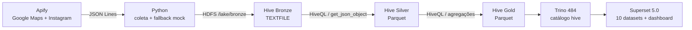

# PI VB — Lakehouse AGR Goiás

Pipeline de dados da **AGR — Agência Goiana de Regulação, Controle e Fiscalização
de Serviços Públicos**, cobrindo coleta, organização em lakehouse e consumo
analítico.

```
Python (coleta Apify/mock) → HDFS (Data Lake) → Hive (Bronze/Silver/Gold) → Trino → Superset
```

> **Documento complementar:** [`PASSO_A_PASSO.md`](PASSO_A_PASSO.md) tem o
> registro ainda mais granular (linha do tempo de comandos, mensagens de erro e
> stack traces). Este README é a visão completa, ponto a ponto.

---

## Índice

1. [O que foi feito — resumo executivo](#1-o-que-foi-feito--resumo-executivo)
2. [Ponto a ponto — a construção](#2-ponto-a-ponto--a-construção)
3. [Arquitetura](#3-arquitetura)
4. [Dados coletados (snapshot)](#4-dados-coletados-snapshot)
5. [Estrutura do repositório](#5-estrutura-do-repositório)
6. [Pré-requisitos](#6-pré-requisitos)
7. [Como rodar](#7-como-rodar)
8. [Modelo de dados (Bronze/Silver/Gold)](#8-modelo-de-dados-bronzesilvergold)
9. [Resultados validados](#9-resultados-validados)
10. [Erros encontrados e correções](#10-erros-encontrados-e-correções)
11. [Decisões e justificativas](#11-decisões-e-justificativas)
12. [Segurança e custos](#12-segurança-e-custos)

---

## 1. O que foi feito — resumo executivo

1. **Coleta real via Apify** de duas fontes públicas da AGR: o lugar no
   **Google Maps** (com avaliações) e o perfil **Instagram `@agrgoias`**.
2. **Organização em lakehouse** com três camadas no Hive: **Bronze** (dados
   brutos), **Silver** (limpos/tipados) e **Gold** (10 tabelas analíticas).
3. **Stack completa em Docker Compose**: HDFS (Hadoop 3.3.6), Hive 3.1.3,
   Trino 484, Superset 5.0.0 e PostgreSQL 15.
4. **Validação de ponta a ponta**: HDFS → HiveQL → Trino (consultas reais) →
   Superset (10 datasets e 12 gráficos).
5. **Dashboard publicado** no Superset, validado visualmente com Chrome headless.

Resultado final (números do snapshot):

- Google Maps: nota **3,2**, **32 avaliações**;
- Instagram: **5.411 seguidores**, **14 posts**, 762 curtidas, 42 comentários;
- Taxa de engajamento: **1,061%**;
- Sentimento: **17 positivos / 1 neutro / 14 negativos**.

---

## 2. Ponto a ponto — a construção

### Etapa 1 — Descoberta e validação do Apify

- O diretório `PI VB` estava vazio; o repositório git era a home do usuário.
- Validei o **token do Apify** (`GET /v2/users/me`): plano Free, US$ 5/mês,
  uso inicial zero.
- Inspecionei o **schema de entrada** dos atores antes de rodar, para não
  gastar créditos com input inválido.

**Decisão:** usar apenas três execuções (perfil, posts e lugar/avaliações) e
limitar a coleta.

### Etapa 2 — Extração com Apify

Atores usados:

| Fonte | Ator | Objetivo |
|-------|------|----------|
| Google Maps | `compass/crawler-google-places` | dados do lugar + avaliações |
| Instagram | `apify/instagram-scraper` (`details`) | perfil |
| Instagram | `apify/instagram-scraper` (`posts`) | posts |

Dois erros de validação foram corrigidos:

1. `scrapeSocialMediaProfiles` é **objeto**, não booleano → removi o campo.
2. `countryCode` deve ser minúsculo → `br` (não `BR`).

Após ajustar `maxReviews` para 50, o Google Maps retornou **32 avaliações**.

**Resultado:** dados brutos + versão normalizada (JSON Lines) para o Hive ler
com `get_json_object`, sem depender de SerDe JSON externo.

### Etapa 3 — Escolha da stack

| Componente | Versão | Por quê |
|------------|--------|---------|
| Hadoop | 3.3.6 | HDFS single-node estável |
| Hive | 3.1.3 | compatível com o conector do Trino; Hive 4.x ainda em aberto no Trino |
| Trino | 484 | versão atual (exige ajuste de HDFS) |
| Superset | 5.0.0 | datasets/dashboards via API/modelos |
| PostgreSQL | 15 | metadados do Hive e do Superset |

**Decisão:** Hive em **MapReduce local** (volume pequeno, sem YARN).

### Etapa 4 — Consolidação da estrutura

Surgiu uma estrutura paralela (de outra sessão) no mesmo diretório. Consolidei
em **uma única estrutura canônica**, aproveitando o melhor das duas:

- coleta com **fallback mock** (requisito de apresentação);
- Silver/Gold **100% em HiveQL**;
- análises de **sentimento, temas e frequência**;
- infraestrutura moderna.

Arquivos duplicados foram removidos; os dados reais ficaram em `dados/`.

### Etapa 5 — Coleta canônica e fallback

`coleta/coletar_dados.py` grava:

```
dados/dados_instagram.json        14 posts (1 por linha)
dados/dados_google.json           32 avaliações
dados/dados_instagram_perfil.json 1 perfil
dados/dados_google_local.json     1 registro do lugar
dados/metadados.json              metadados
dados/raw/                        respostas brutas (auditoria)
```

Fallback automático (`coleta/gerar_mock.py`): sem token, falha/limite do Apify
ou plataforma vazia → dados sintéticos no mesmo schema.

**Decisão:** Python só coleta/normaliza; o tratamento analítico fica no Hive.

### Etapa 6 — Infraestrutura Docker

- **HDFS**: `core-site.xml` + `hdfs-site.xml` + entrypoints NameNode/DataNode.
- **Hive**: `hive-site.xml` (metastore em Postgres, warehouse no HDFS), driver
  JDBC PostgreSQL **42.7.12** (removido o 9.4 da imagem).
- **Trino**: catálogo Hive com `fs.hadoop.enabled=true` (HDFS exige isso na 484).
- **Superset**: imagem lean + `psycopg2-binary` + `trino[sqlalchemy]==0.335.0`
  instalados via `uv` no venv.
- **PostgreSQL**: banco `metastore` + banco `superset`, `trust` no laboratório.
- **Windows/Git Bash**: `scripts/_compose.sh` resolve o `docker` e o caminho do
  Compose com `cygpath -w`.

### Etapa 7 — Camadas HiveQL

- `hive/01_bronze.sql` — 4 tabelas externas `TEXTFILE` (uma coluna `line`).
- `hive/02_silver.sql` — CTAS com `get_json_object`, limpeza, tipagem,
  normalização de acentos, dia da semana, e visão unificada `interacoes`.
- `hive/03_gold.sql` — **10 tabelas** em Parquet (engajamento, sentimento,
  temas, frequência, evolução, tipo de mídia, KPIs, top posts, notas, recentes).

### Etapa 8 — Instalação do Docker e subida da stack

- Docker Desktop instalado via `winget` (elevado/UAC): **29.9.3**, Compose 5.7.0.
- Build das imagens e subida com volumes limpos.

### Etapa 9 — Incidentes corrigidos (detalhes na seção 10)

1. Containers órfãos → `down --remove-orphans`.
2. Hive × PostgreSQL 15 (`authentication type 10`) → driver JDBC 42.7.12.
3. Trino 484 rejeitou propriedades → `fs.hadoop.enabled=true`.
4. Metastore escutando só IPv6 → `preferIPv4Stack` + bind `0.0.0.0`.
5. `OutOfMemoryError` na Gold → `HADOOP_HEAPSIZE=2048`.
6. Superset `Working outside of application context` → imports dentro do contexto.
7. KPIs com erro de coluna temporal → `big_number_total`.

### Etapa 10 — Carga e validação

- Upload dos 4 arquivos para `/lake/bronze`.
- Execução de `00 → 01 → 02 → 03` (HiveQL).
- Validação **somente leitura** no Trino (contagens e integridade).
- Datasets no Superset: **10 datasets**, **49 colunas**.
- Dashboard: **12 gráficos** criados e validados com Chrome headless.

---

## 3. Arquitetura



| Camada | Formato | Conteúdo |
|--------|---------|----------|
| Bronze | JSON Lines / TEXTFILE | um registro por linha, como veio do Apify |
| Silver | Parquet | limpeza, tipagem, texto normalizado, visão unificada |
| Gold | Parquet | 10 tabelas analíticas prontas para BI |
| Consumo | SQL | Trino consulta; Superset consome a Gold |

---

## 4. Dados coletados (snapshot)

Coleta real via Apify (18/11/2026):

| Fonte | Dado | Valor |
|-------|------|-------|
| Google Maps | Nome | AGR — Agência Goiana de Regulação… |
| Google Maps | Categoria | Repartição pública |
| Google Maps | Nota | **3,2** |
| Google Maps | Avaliações | **32** |
| Google Maps | Endereço | Av. Goiás, 305 — Setor Central, Goiânia/GO, 74005-010 |
| Google Maps | Telefone | +55 62 3226-6400 |
| Instagram | Usuário | `@agrgoias` (verificado) |
| Instagram | Seguidores | **5.411** |
| Instagram | Posts | **14** |
| Instagram | Curtidas / comentários | 762 / 42 |

Distribuição de notas: 5★=15, 4★=2, 3★=1, 2★=1, 1★=13.

---

## 5. Estrutura do repositório

```
PI VB/
├── coleta/                     # Python (Apify + fallback mock)
│   ├── coletar_dados.py        # coleta e grava JSON Lines
│   ├── normalizar.py           # schema canônico em português
│   ├── gerar_mock.py           # fallback sintético
│   └── requirements.txt
├── dados/                      # Bronze local (gitignored)
├── infra/
│   ├── docker-compose.yml      # HDFS, Hive, Trino, Superset, PostgreSQL
│   ├── conf/                   # core-site, hdfs-site, hive-site, mapred-site
│   ├── hadoop/                 # entrypoints NameNode/DataNode
│   ├── hive/Dockerfile         # Hive 3.1.3 + driver PostgreSQL 42.7.12
│   ├── trino/catalog/          # conector Hive (fs.hadoop.enabled)
│   ├── superset/               # imagem, config, init, datasets, dashboard
│   ├── postgres/init/          # banco de metadados do Superset
│   └── .env.example
├── hive/
│   ├── 00_databases.sql        # bronze, silver, gold
│   ├── 01_bronze.sql           # tabelas externas sobre JSON Lines
│   ├── 02_silver.sql           # HiveQL: limpeza, tipagem e interacoes
│   ├── 03_gold.sql             # HiveQL: 10 tabelas analíticas
│   └── queries_trino.sql       # consultas de exemplo
├── scripts/
│   ├── 00_verificar_ambiente.sh
│   ├── 01_coleta.sh
│   ├── 02_upload_bronze.sh
│   ├── 03_hive_layers.sh
│   ├── 04_pipeline_completo.sh # 6 etapas
│   ├── 05_superset_datasets.sh
│   ├── 06_consultar_trino.py
│   ├── 07_parar.sh
│   ├── 08_criar_dashboard.sh
│   ├── _compose.sh             # helper Windows (docker/cygpath)
│   └── 99_status.sh
├── docs/
│   ├── superset_dashboard.md   # receitas/ajustes dos gráficos
│   ├── resumo_coleta.md
│   ├── validacao_dashboard.png
│   └── validacao_kpi.png
├── PASSO_A_PASSO.md            # registro granular (ações, erros, decisões)
├── Makefile
└── README.md
```

---

## 6. Pré-requisitos

- **Docker Desktop** com backend **WSL2** (Windows 11).
- **8 GB de RAM** no mínimo (12 GB recomendado).
- **Python 3.11+** e `pip install -r coleta/requirements.txt` (apenas `apify-client`).
- Token do **Apify** (opcional: sem token o pipeline usa mock).

> O Docker não estava instalado no início; foi instalado durante o projeto
> (seção 8 do passo a passo).

### Instalando o Docker no Windows 11 Home

```powershell
wsl --install        # PowerShell admin, reiniciar
# instalar o Docker Desktop e habilitar WSL2
```

---

## 7. Como rodar

```bash
cp .env.example .env                 # informe APIFY_TOKEN
cp infra/.env.example infra/.env     # troque SUPERSET_SECRET_KEY

# Pipeline completo (coleta → HDFS → Hive → Trino → Superset → dashboard)
bash scripts/04_pipeline_completo.sh

# Sem token do Apify:
bash scripts/04_pipeline_completo.sh --mock
```

### Passo a passo (alternativo)

```bash
bash scripts/01_coleta.sh            # coleta (Apify ou mock)
docker compose -f infra/docker-compose.yml up -d --build
bash scripts/02_upload_bronze.sh     # HDFS
bash scripts/03_hive_layers.sh       # Bronze/Silver/Gold
bash scripts/05_superset_datasets.sh # 10 datasets
bash scripts/08_criar_dashboard.sh   # 12 gráficos + dashboard
```

### Consultas

```bash
python scripts/06_consultar_trino.py "SELECT * FROM hive.gold.kpis"
```

### URLs

| Serviço | URL |
|---------|-----|
| HDFS NameNode | http://localhost:9870 |
| Trino | http://localhost:8080 |
| Superset | http://localhost:8088 (`admin`/`admin`) |
| Dashboard | http://localhost:8088/superset/dashboard/agr-engajamento-digital/ |

### Parada

```bash
bash scripts/07_parar.sh             # mantém volumes
bash scripts/07_parar.sh --volumes   # apaga tudo
```

---

## 8. Modelo de dados (Bronze/Silver/Gold)

### Bronze (JSON Lines, `line STRING`)

`instagram_raw`, `google_raw`, `instagram_perfil_raw`, `google_local_raw`.

### Silver (Parquet, HiveQL)

| Tabela | Grão | Principais colunas |
|--------|------|--------------------|
| `instagram` | 1 post | `id`, `texto`, `data`, `curtidas`, `comentarios`, `tipo_midia`, `engajamento` |
| `google` | 1 avaliação | `id`, `texto`, `data`, `nota`, `autor` |
| `instagram_perfil` | 1 linha | `usuario`, `seguidores`, `posts`, `verificado` |
| `google_local` | 1 linha | `nome`, `nota_media`, `total_avaliacoes`, `endereco` |
| `interacoes` | união das duas fontes | + `plataforma`, `tipo`, `dia_semana`, `hora`, `ano_mes` |

Colunas derivadas: `texto_normalizado` (sem acentos), `data_dia`, `hora`,
`dia_semana`, `ano_mes`.

### Gold (Parquet, HiveQL)

1. `engajamento_plataforma`
2. `sentimento_google` — Positivo (4–5) / Neutro (3) / Negativo (1–2)
3. `temas` — palavras-chave em legendas e avaliações
4. `frequencia_engajamento` — dia × hora
5. `evolucao_temporal`
6. `engajamento_tipo_midia`
7. `kpis`
8. `instagram_top_posts`
9. `google_maps_avaliacoes_por_nota`
10. `google_maps_avaliacoes_recentes`

---

## 9. Resultados validados

### Contagens por camada (Trino, read-only)

| Camada | Resultado |
|--------|-----------|
| Bronze | 14 posts + 32 avaliações + 1 perfil + 1 local |
| Silver | `instagram` 14 · `google` 32 · `interacoes` 46 |
| Gold | 10 tabelas |

### Integridade

- `interacoes` (46) = `instagram` (14) + `google` (32);
- sentimento soma **32** avaliações;
- notas somam **32**;
- frequência soma **14** posts;
- zero nulos/duplicados nas chaves.

### KPIs

```
media_curtidas_instagram     54.43
media_engajamento_instagram  57.43
media_nota_google             3.16   (nota do local: 3.2)
seguidores_instagram       5411.0
taxa_engajamento_pct          1.061
total_avaliacoes_google      32.0
total_interacoes_instagram   804.0
total_posts_instagram        14.0
```

### Superset

- Conexão **`Trino AGR`** (`trino://admin@trino:8080/hive`);
- **10 datasets** Gold;
- **49 colunas** no total;
- Dashboard **“AGR — Engajamento Digital”** com **12 gráficos**:

| # | Gráfico | Tipo |
|---|---------|------|
| 1–4 | Seguidores, Posts, Avaliações, Taxa de Engajamento | Big Number |
| 5–8 | Sentimento, Temas, Notas, Tipo de Mídia | Pizza |
| 9–12 | Top Posts, Avaliações Recentes, Evolução, Plataforma | Tabela |

Validação visual com Chrome headless: **12/12 componentes renderizados**, sem
erros, KPIs exibidos (**5.41k / 14 / 32 / 1.06**). Screenshots em
[`docs/validacao_dashboard.png`](docs/validacao_dashboard.png) e
[`docs/validacao_kpi.png`](docs/validacao_kpi.png).

---

## 10. Erros encontrados e correções

| # | Erro | Causa | Correção |
|---|------|-------|----------|
| 1 | `scrapeSocialMediaProfiles must be object` | campo é objeto, não booleano | removido do input |
| 2 | `countryCode must be equal to allowed values` | país deve ser minúsculo | `BR` → `br` |
| 3 | containers órfãos (`agr-namenode already in use`) | tentativa anterior | `down --remove-orphans` + remoção manual |
| 4 | `authentication type 10 is not supported` | driver JDBC 9.4 × PostgreSQL 15 (SCRAM) | driver 42.7.12 + `trust` |
| 5 | Trino: `Configuration property ... was not used` | HDFS não habilitado por padrão na 484 | `fs.hadoop.enabled=true`, remover props obsoletas |
| 6 | `Connection refused` na 10000 | metastore escutando só IPv6 (`:::9083`) | `preferIPv4Stack` + bind `0.0.0.0` |
| 7 | Gold: `OutOfMemoryError: Java heap space` | HiveServer2 com `-Xmx256m` | `HADOOP_HEAPSIZE=2048` |
| 8 | `docker exec -T` flag inválida | `-T` é do `compose exec` | usar `exec` sem `-T` |
| 9 | Superset: `Working outside of application context` | modelos acessam `app.config` no import | imports dentro de `app_context` |
| 10 | KPI: `Datetime column not provided` | `big_number` exige coluna temporal | usar `big_number_total` |

---

## 11. Decisões e justificativas

| Decisão | Motivo |
|---------|--------|
| Validar token/atores antes de rodar | evitar custo e inputs inválidos |
| Bronze JSON Lines + `get_json_object` | sem dependência de SerDe JSON externo |
| Silver/Gold em HiveQL | requisito de tratamento na camada Hive |
| Hive 3.1.3 (não 4.x) | compatível com o conector Hive do Trino |
| MapReduce local | volume pequeno; evita YARN |
| `fs.hadoop.enabled=true` no Trino 484 | HDFS não é habilitado por padrão |
| JDBC 42.7.12 | PostgreSQL 15 usa SCRAM-SHA-256 |
| `preferIPv4Stack=true` | bind do metastore saía só em IPv6 |
| `HADOOP_HEAPSIZE=2048` | CROSS JOIN da Gold estourava 256 MB |
| `trino[sqlalchemy]==0.335.0` | compatível com o pin de `requests` do Superset 5 |
| `psycopg2-binary` no venv | imagem lean não traz o extra `[postgres]` |
| Imports do Superset dentro do app context | modelos acessam `app.config` no import |
| `big_number_total` nos KPIs | `big_number` exigia coluna temporal |
| `_compose.sh` com `cygpath` | Docker CLI no Windows não entende `/c/...` |
| Fallback mock na coleta | garante a apresentação sem token/créditos |

---

## 12. Segurança e custos

- Token do Apify **não versionado** (`.env`/variável de ambiente).
- `infra/.env` e `dados/` no `.gitignore`.
- Ambiente de **laboratório**: HDFS sem permissões, Trino sem autenticação,
  Superset em HTTP. Não expor as portas na internet.
- Custo do snapshot no Apify: **menos de US$ 0,10**.
- Limitações: stack single-node; HDFS replication 1; sem YARN; sem TLS; dados
  do snapshot (sem atualização em tempo real).
